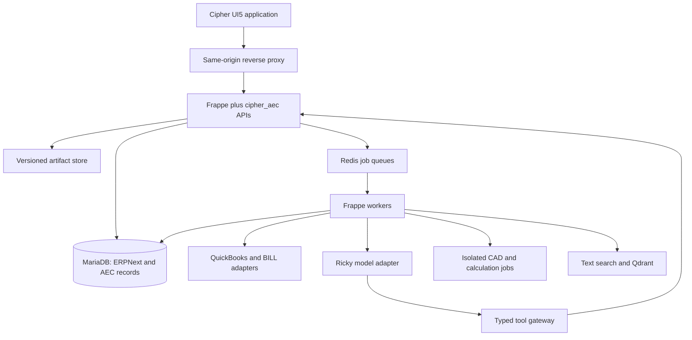

# Cipher — The AEC/CMS Pro

**Implementation authorized:** The owner instructed “Execute this plan as written and do not stray” on October 15, 2026. Implementation is now active under this framework. Earlier pending-approval/planning-only markers describe the completed draft stage and no longer block coding. Astra ultra owns orchestration/reviews/escalations; all implementation subagents use GPT-6.1 Sol.

# Backend framework and autonomous implementation specification

**Draft 1 • October 15, 2026 • Planning only — awaiting owner implementation authorization**

This is the reviewable framework for the entire Cipher ERP/CMS product, including its SAP UI5 interface and embedded Ricky intelligence. It is a new design derived from the owner’s current business requirements and selected open-source foundations. No prior Cipher or Odoo architecture, schema, workflow, UI, test suite or implementation is a design input or compatibility requirement. Odoo is solely the interim operating system. The explicitly requested existing Ricky model is an external capability to integrate through the new contracts, not an inherited ERP architecture. No application implementation is authorized by creation of this document. After the owner approves this framework, the implementation agent follows the dependency-ordered backlog without repeatedly asking for routine technical decisions.

This draft defines target behavior, not capabilities already delivered. SAP S/4HANA and Trimble Construction One are capability benchmarks; this document does not claim feature parity or access to their proprietary code. A complete first internal release is bounded below. Enterprise maturity requires subsequent operating evidence.

## Contents

1. Approval scope and completion boundaries
2. Architecture decisions and system topology
3. Repository skeleton and implementation conventions
4. Identity, policy and transaction design
5. Integration, accounting and synchronization
6. Documents, engineering and offline work
7. Deployment, operations and quality
8. Autonomous execution and decisions
9. Domain data contracts (appendix A)
10. API, UI and Ricky contracts (appendix B)
11. Execution backlog, dependency graph and completion matrix (companion files)

## 1. Approval scope and bounded completion

Approving this framework authorizes implementing the described source code, dependencies, migrations, synthetic/sandbox integrations, local/container deployments, verification, fixes and reviewable PR work. It does not itself authorize payments, messages to outside parties, a production data cutover, production deployment, purchases or model training on company records. These are environment/business actions with specific factual prerequisites, not decisions to revisit the selected framework.

### Release ladder

| Release | Deliverable | What is sufficient to finish |
|---|---|---|
| R0 Foundation | Persistent ERPNext, custom app, UI5 shell, identity boundary, artifacts, Ricky gateway | Connected project/document/Ricky/draft-save journey; restart and permission checks; actual browser evidence |
| R1 Commercial/project operations | Pursuit, proposals, estimates/takeoff, award, WBS/budget, procurement | Accepted source-linked estimate becomes project/contract/budget/PO/partial receipt without rekeying |
| R2 Construction finance | Supplier applications/AP, owner applications/AR, retainage, credits, reconciliation | Complete controlled invoice lifecycle and durable provider adapter; provider-dependent claims bounded by actual sandbox/live evidence |
| R3 Integrated internal ERP/CMS | Field, engineering, document control, scheduling, changes, workforce/equipment, libraries, closeout | Every required internal scenario in the completion matrix operates through the unified UI, with permissions/recovery |
| R4 Operational rollout | Qualified identity/provider configuration, optional business-data onboarding, backups/runbooks | Reconciled cutover and verified recovery on the actual approved operational environment |
| R5 Enterprise development | Multi-company/tenant qualification, enterprise identity, retention, volume and support | Measured enterprise requirements and operating evidence; not silently included in a claim that R3 is Fortune 500 ready |

All requested AEC scope remains in the backlog. R0 is the first proof of architecture, not a reduction of the product to a demo. R1–R3 are implementation completion targets; external dependency status is recorded separately. R4 cannot be truthfully completed with invented company data, credentials or policy.

### Operating defaults

Start with one S&A company, USD base currency, configurable company timezone and US formats. Build company scoping into records now. Do not infer the owner's actual fiscal year, tax treatment, retainage rates, contractual limits or approval thresholds. Use clearly labeled synthetic fixture values and configurable required settings; live financial commands reject unset required policy while development continues.

One Frappe site is the deployment/tenant isolation boundary. A site may contain several permitted companies, but every company-scoped record, query, job and cache key must include company context. Future unrelated customers receive separate sites/databases by default. Avoid premature shared-database SaaS tenancy. Site administrator is a powerful operational role; document and audit its use rather than pretending custom permissions prevent host/database administrators from all access.

The normal application is Cipher UI5. ERPNext Desk is restricted administrative tooling, not a second end-user product. Local inference may run on separate hardware while remaining part of the same user experience.

## 2. Architecture decisions

| ID | Decision | Implementation consequence |
|---|---|---|
| ADR-001 | UI5 Web Components for React, modern Horizon theme | Use official shell/page patterns; no navy prototype shell or proprietary SAP runtime |
| ADR-002 | ERPNext/Frappe modular monolith | Use standard business documents and one authoritative transactional database per site |
| ADR-003 | `cipher_aec` custom app, no ERPNext core fork | Hooks/extensions/custom DocTypes and controlled migrations; pinned upgrade compatibility |
| ADR-004 | ERPNext operational accounting, QuickBooks official books | Explicit posting/outbox/readback/reconciliation states; one operational ledger with independently acknowledged official-book delivery |
| ADR-005 | Same-origin web application and Frappe session boundary | Server-derived identity, CSRF protection, no provider or model credentials in browser |
| ADR-006 | Domain commands in Frappe transactions | Invariants shared by HTTP, jobs, admin and tools; no separate business-rule BFF |
| ADR-007 | Database outbox/inbox with Frappe workers | Redis queues are delivery hints, not authoritative financial job state |
| ADR-008 | Existing local Ricky through adapter | No new model training or mandatory migration to a speculative serving framework |
| ADR-009 | Versioned artifact storage and permission-aware retrieval | Source bytes and revisions durable; vectors/search are rebuildable derived indexes |
| ADR-010 | Qdrant for introduced semantic retrieval | Scope/policy checks before context and before citation retrieval; no business truth in vectors |
| ADR-011 | REST/typed JSON commands; versioned tool schemas | Stable public contracts, generated TypeScript types, explicit error semantics |
| ADR-012 | Append-only business history and corrections | No rewriting issued revisions or original operation receipts; record reversals and replacements |
| ADR-013 | SQL reporting projections first | Reuse ERPNext reports; no speculative separate warehouse or event-sourced rewrite |
| ADR-014 | Docker Compose for development/single-site deployment | Reproducible services; no Kubernetes requirement for initial internal release |
| ADR-015 | OpenTelemetry-compatible traces and structured logs | Correlation across request, transaction, worker, model and specialist job |
| ADR-016 | Explicit integration ownership | One nominated creator per external invoice/payment; prevent callback loops |
| ADR-017 | Frappe HR/HRMS for applicable workforce modules | Reuse the compatible open-source app for Expense Claim and HR workflows; payroll provider remains authoritative |

### Runtime topology



This is a logical topology. Model tool calls return to the orchestration worker/gateway; the inference endpoint never receives a broad Frappe administrator token. Tool outputs are data, not executable instructions. Heavy CAD execution is isolated from finance workers.

### Version and dependency policy

The earlier review observed UI5 React 2.27.3 and ERPNext/Frappe version-16 branch versions; these are source observations, not a tested deployment lock. During R0 choose a mutually supported released pair and record image digests, app commits, Python/Node/database versions and lockfiles in `platform/versions.lock.json`. Do not invent a digest in this planning draft. The first resolved matrix becomes authoritative; upgrades are explicit changes with migration/recovery checks.

UI5 React is Apache-2.0, Frappe MIT and ERPNext and Frappe HR/HRMS GPLv3. Track transitive dependencies and model/tool/data licenses separately. Use only a licensed compatible document renderer/CAD tool for each format. Keep proprietary SAPUI5/Fiori Elements runtime out of the baseline. Packaging/distribution obligations must be reviewed against actual artifacts before external commercialization.

## 3. Repository skeleton and coding conventions

The planning skeleton contains README specifications, not importable packages, fake endpoints or stub methods that claim success. Future implementation locations are reserved below.

```text
apps/cipher/
  docs/framework/
    BACKEND_FRAMEWORK.md          # this assembled authoritative draft
    EXECUTION_BACKLOG.md          # work packages and dependency order
    COMPLETION_MATRIX.md          # user journeys and failure evidence
    DECISIONS_AND_DEPENDENCIES.md # defaults versus missing external facts
    SOURCE_MANIFEST.json         # planning provenance; not runtime qualification
  platform/
    README.md
    deployment/README.md          # future compose, proxy, env schema, health
    operations/README.md          # future backup/restore/migrate/diagnostics
    apps/cipher_aec/
      README.md
      cipher_aec/
        api/README.md
        governance/README.md
        commercial/README.md
        estimating/README.md
        projects/README.md
        procurement/README.md
        construction_finance/README.md
        field/README.md
        engineering/README.md
        documents/README.md
        workforce_assets/README.md
        reporting/README.md
        integrations/README.md
        ricky/README.md
        migrations/README.md
        tests/README.md
  product/README.md               # future single UI5 application
```

Create DocTypes with Frappe tooling and commit their JSON/controller definitions under module DocType directories. The domain directories above describe ownership; final generated Frappe paths follow supported conventions. A domain service orchestrates standard ERPNext documents rather than creating a second customer/invoice/project table. Shared infrastructure depends on neither UI nor model implementation. Domain code uses narrow integration interfaces rather than calling vendor APIs inside document controllers.

Code organization: thin request validation → authenticated command context → domain service → authoritative document transaction → durable outbox → after-commit scheduling. Query presenters return business-facing read models with permission checks; they do not expose arbitrary DocType fields. Custom fields on standard documents have a namespaced prefix and explicit migration ownership.

Every custom mutable aggregate has company/project scope as appropriate, stable ID, current business revision, lifecycle status, actor/time metadata and source references. Frappe document `name` remains the database identifier; display numbers are not global cross-system keys. Define uniqueness in migrations, not merely client validators. Child rows carry stable line IDs so reordered SOV/estimate rows preserve mappings. JSON timestamps are UTC ISO-8601; local display uses company/user settings. Date-only contract/business dates remain date-only.

Money crosses APIs as decimal strings with currency. Use Decimal calculation and explicit currency rounding; no binary floating-point money or client-trusted totals. Quantities have decimal value, unit, precision and conversion provenance. Keep rate precision distinct from rounded currency totals. Computation policy is versioned; persist inputs and rounding rules for approved/issued snapshots. Database field precision must accommodate supported currencies/rates and be proven by boundary tests.

## 4. Identity, permission and transaction design

### User and authority model

Reuse Frappe User/Role/Role Profile/permissions and implement project duty/membership records where necessary. Canonical person links all authenticated identities belonging to one human; alias accounts do not satisfy independent review. Service identities are distinct, narrowly scoped and never fabricated human approvers. Entra is the initial operational federation direction, with synthetic local accounts for development. Use a supported, validated OIDC/OAuth integration for the pinned runtime; assert issuer/audience/nonce/state and server-side binding. Session expiration/revocation must invalidate tools and long-running jobs at their next effect boundary.

Roles include estimator, commercial reviewer, project manager, procurement, AP preparer, controller/accountant, AR/billing, field supervisor, engineer/checker, document controller and administrator. Roles are capability groupings, not unconditional global data access. Authorization combines authenticated identity, active company, current project membership, duty, operation class and document status. Query filters and per-record checks enforce scope. API routes and UI navigation use the same capability catalog but the server always decides.

For consequential actions define policy-driven required duties, self-approval restrictions, amount/category thresholds and delegated scope. Default synthetic policies use independent actors. If live policy is missing, deny the consequential live action with a specific setup requirement. Normal drafts, read work, UI development and fixtures continue.

### Command algorithm

1. Authenticate, derive tenant/company/person and validate command schema and supported version.
2. Verify current read/action permission before returning prior results, to prevent replay leaking records after access removal.
3. Reserve `(site, canonical_person, operation_id)` with command, company and payload bound into the request hash under a uniqueness constraint. Same ID/different request returns conflict. Same authorized completed request returns its original receipt.
4. Lock/re-read target aggregate and required source/governor versions. Verify expected revision, lifecycle, period and approval policy. Use deterministic lock ordering for multi-record operations.
5. Recompute quantities/money/effects from authoritative sources. Build or check approval manifest: actor duties, operation, subject, versions, amount/currency, policy version, destination and expiry.
6. Apply standard ERPNext and custom document changes in one database transaction. Persist consumed approval, command receipt, history and outbox rows atomically. No remote HTTP request occurs inside this transaction.
7. Commit, then enqueue pending outbox IDs. If queue submission fails, the scheduler finds committed pending rows and retries.
8. Return the durable result and new versions. Async work returns an operation/run ID and observable state, never a false synchronous success.

Frappe generic insert/save/submit/cancel endpoints, background imports and Desk actions must not bypass invariants. Put essential guards in document hooks/controllers as well as services; restrict general permissions to prevent unsupported transitions. Server-only execution context is not caller-supplied JSON. Avoid globally using `ignore_permissions` to make the UI work. Admin repair requires a documented exceptional procedure and history.

### Concurrency, corrections and lifecycle

Revision checks produce conflicts rather than last-write-wins for financial, issued or contract records. Draft text editing may support an explicit merge workflow. Approvals become stale when material source data, policy, destination, rights or relevant membership changes; current validity is calculated, not inferred from an old green status.

Never erase a posted business fact to correct it. Use standard ERPNext cancellation/amendment/reversal mechanisms as appropriate, plus immutable Cipher correction lineage. Verify upstream/downstream consequences before canceling. Business approval is distinct from operational posting, issue/send, external acknowledgment and payment. Permission changes do not rewrite historical actor identity.

### Durable audit and restoration

Persist append-only command and state-transition history including correlation IDs, actor, policy and source versions. Restrict mutation paths and include checksums; this alone is not tamper-proof against a database administrator. Add signed/external checkpoints for stronger integrity and retain backup history. A restored deployment starts with external delivery and money-related workers disabled until environment identity and last-delivered operation reconciliation are verified. Rebuilding a queue cannot authorize duplicate external actions.

## 5. Accounting and external integrations

### Record ownership

Cipher's UI and APIs own the end-user workflow. ERPNext stores operational customers/suppliers/projects/orders/invoices and GL. QuickBooks is the official book of record initially. For each imported master choose one authoritative editor and synchronize permitted fields; conflicting edits enter a reconciliation queue. Optional later imports map business records from an interim system into Cipher’s independently designed model. No access to Odoo, prior exports or recovered configuration is required to design or implement Cipher. Payment execution follows the verified BILL/QuickBooks route; do not implement two independent creators for the same payment.

### Integration records

- `Cipher External Reference`: provider, environment, company, local doctype/name, remote type/ID, mapping version, last remote version; unique local/remote mappings within the declared type boundary.
- `Cipher Integration Operation`: stable operation ID, payload digest, source version, approved manifest, provider/environment, state, next attempt, lease/fencing token, request/response receipt references.
- `Cipher Delivery Attempt`: append-only start/end, sanitized request/response metadata, outcome class, remote correlation ID and retry decision.
- `Cipher Integration Inbox`: verified provider event ID/hash, received time, processing state and affected mapping; duplicate callbacks do not repeat effects.
- `Cipher Reconciliation Run/Case`: as-of date, source totals, provider totals, unresolved mappings, variance class and resolution references.

States: prepared → authorized → queued → sending → acknowledged or rejected; ambiguous transport outcome → unknown → readback/reconcile → acknowledged/rejected/manual exception. Retryable transient failure is separate from business rejection. Cancellation of a queued request does not cancel an already accepted remote transaction. Lease expiration prevents two local workers from intentionally sending concurrently, but remote idempotency/readback is still required after a process dies mid-call.

Do not assume a provider supports idempotency keys, exact searches, webhooks or a particular document mapping. Implement the actual available API contract; when uniqueness cannot be proven, preserve unknown state and request resolution rather than blindly retrying creation. Verify webhook signatures/replay bounds; polls remain a recovery path. Secrets/OAuth refresh tokens are encrypted through supported secret storage and excluded from logs, exports and the browser.

### Finance defaults and calculations

Supplier and owner SOV lines retain original contract, approved change, revised contract, prior certified, current certified, stored material, retainage and released retainage values. Define period versus cumulative amounts explicitly; retainage must not be subtracted twice. Separate taxable base, tax, discounts and withholding. Contract policy determines eligibility and basis; a universal hard-coded percentage is not acceptable.

Invoice mapping reconciles gross, net, tax, retained liability/receivable, credits, currency and dimension allocations. Supplier/owner application certification does not itself prove an ERPNext invoice or official QuickBooks invoice exists. Operational GL posting and external official accounting acceptance have independent identifiers and dates. Period close blocks incompatible backdated effects and reports open integration uncertainty.

QuickBooks adoption does not postpone AP/AR business work. Build all required preparation, review, correction, billing and collection interfaces inside Cipher. Accounting-policy setup and provider credentials are isolated prerequisites for actual external delivery.

## 6. Documents, engineering and field work

### Artifact pipeline

Upload initiation creates a scoped artifact record with size/type limits. Upload into quarantine; verify bytes/hash and scan before making content available. Store original bytes immutably and link revision metadata to its exact object/version. Parsing/OCR/preview/indexing are async derived jobs with source digest, parser version and failure states. Unsupported or encrypted files remain visible as unprocessed artifacts, not silently successful extraction.

Downloads check current authorization and rights, then issue short-lived scoped access; object keys are not permission grants. Revocation/deletion affects preview caches, search and embeddings. Index updates carry document/project/rights/version metadata; recheck current source permission when assembling Ricky context and opening citations. User-submitted retrieval filters cannot expand authority. Do not use an unrestricted vector query then show its snippets before access filtering.

Issued sets record exact artifact revisions and recipients. Superseding a drawing does not alter what was issued previously. Cross-references distinguish working, reviewed, issued, received and executed records. Contract/spec library licensing controls ingestion, retrieval and distribution independently.

### Engineering jobs

Each job declares tool/version, accepted formats, units, input hashes, parameters, allowed operations, resource/time limits and output schema. Run external tooling in isolated workspaces; no access to host credentials or unrelated projects. Uploaded macros/scripts are not executed by default. Output includes artifacts, computation logs, warnings, assumptions and reproducibility metadata. A review/check record determines accepted status. Civil/structural/MEP and other discipline capabilities are separate adapters and fixtures, not one unverifiable “full AEC AI” flag.

Use existing Ricky tools where recoverable. PDF measurement, IFC metadata/view coordination and CAD execution each need suitable maintained libraries/tool licenses and numerical validation; choose compatible dependencies during implementation and record decisions. Professional judgment, issued calculations and seals remain accountable acts.

### Offline field synchronization

Offline support applies to bounded drafts: observations, photos, time/quantity drafts and daily reports. The client stores device operation IDs, base revisions and queued attachments. Sync authenticates again, checks permissions, deduplicates and detects conflicts. Never silently last-write-wins accepted quantities, approved time or issued records. Financial release and formal issue require online authority. Expose queued/conflict/failed/uploading states; remote deletion/revocation purges cached records according to configured device policy. Minimize and encrypt sensitive local caches where platform support permits; document residual risks.

## 7. Deployment, reliability and acceptance

### Environment profiles

Development: synthetic site, local accounts, local artifact adapter, provider simulators clearly labeled, optional Ricky endpoint. Integration: full stack, isolated provider sandbox where available, actual model/tool adapters, reproducible fixtures. Operational: approved secrets/identity, persistent volumes, monitored workers, tested backups, explicit external delivery enablement. Never promote a synthetic workspace by flipping a caller-controlled flag.

Services: reverse proxy, frontend build assets, Frappe web, websocket if required, short/default/long workers, scheduler, MariaDB, Redis cache/queue, artifact storage and optional Qdrant. Heavy inference/CAD can be separate workers/hosts behind authenticated adapters. Health checks distinguish alive, ready, degraded dependency and blocked delivery. Expose normal ERP functionality during model unavailability.

The known Docker `vfs` extraction failure requires adequate supported storage provisioning before repeating the image pull. Capacity-check disk and inodes, account for extraction/build overhead and avoid copying the repository's committed node_modules into worktrees/images. Do not solve disk pressure by deleting unrelated work. Record a reproducible recovery path if the environment remains insufficient.

### Backups and upgrades

Back up database, artifact versions, encryption/secret recovery material through an approved secure path, app versions and provider operation state. A database-only backup without artifact consistency is incomplete. Restore to an isolated site, verify checksums and representative journeys, keep outbound providers quarantined and reconcile external operation IDs before enabling delivery. Initial target: daily full recovery checkpoint plus database log/managed incremental recovery where supported; proposed operational RPO 1 hour/RTO 4 hours must be measured against the chosen hosting, not claimed in advance.

Migrations are idempotent or explicitly resumable and versioned. Add fields before migrating data and switching reads; remove old fields only in a later compatible release. Record source counts/digests and failed rows. Test supported upgrade paths on representative data. Rollback means restoring a verified compatible deployment/data checkpoint or a forward repair; do not assume every schema migration can safely run backward.

### Quality gates owned by engineering

Checks correspond to risk: exact money/unit tests, real Frappe/MariaDB integration tests, permissions through direct routes, API contracts, worker failure/recovery, provider sandbox/readback, browser workflows, accessibility and load. A passing stubbed test is not evidence of provider integration. Test the generic ERP paths and background jobs that could bypass custom commands. Use synthetic source fixtures with labeled expected outcomes; no meaningless count target.

Proposed performance workload for internal qualification: 25 concurrent active users, 100 active projects, 100,000 finance/operational records and 1 million metadata/search rows with paged APIs. Measure p95 reads under 2 seconds and local command acknowledgment under 3 seconds excluding declared external jobs. Large files/jobs report asynchronous progress. Adjust capacity or queries to meet measured targets; record actual dataset/hardware/results. These are engineering starting targets, not inferred current company volumes.

A release evidence folder records source commit/digest, environment/version matrix, commands, results, known failures and actual browser screenshots at desktop/tablet/phone widths. Screenshots alone cannot prove data durability; restart/reconciliation/access results accompany them. Never label a mocked model/provider as connected.

## 8. Autonomous execution contract

After framework approval, follow `EXECUTION_BACKLOG.md` in dependency order. Start independent work when prerequisites permit; a missing live integration credential does not stop the UI, schema, synthetic integration, recovery or other modules. Default to the selected framework and established coding conventions. Resolve routine library versions, naming, query/index choices, component composition and reversible internal refactors without asking the owner.

Maintain one Astra ultra orchestration/escalation agent and GPT-6.1 Sol implementation agents per the owner's model direction. Existing agent identities must have verified configuration. The orchestrator owns contracts, dependency sequencing and cross-domain decisions; agents own bounded paths/work packages. Avoid concurrent edits to the same schema or central contract. One integration owner reconciles changes and runs relevant checks. Do not proliferate full worktrees or copy node_modules.

Dependency readiness requires implemented and locally verified schemas/services/contracts, not completion of every external acceptance item. Track `local_contract_status` separately from `external_qualification_status`. Labeled provider/model fixtures can qualify the local adapter boundary but never a live connection; missing external access does not hold unrelated downstream work. Each work package records status (`planned`, `ready`, `active`, `blocked_external`, `implemented`, `verified`), source changes, tests/evidence and next dependency. A blocked package identifies the exact missing fact and best independent next work. Do not use “done” for a stub, seeded screenshot, unauthenticated endpoint or mocked provider call.

Checkpoint after meaningful increments: update handoff, backlog status, unresolved defects, running jobs, worktree/branch and next concrete command. Commit only after applicable repository-required checks pass. Maintain small coherent commits and draft PR descriptions centered on delivered behavior. Preserve unrelated dirty work. Never merge/deploy externally merely because implementation is authorized unless that action is separately within the owner's scope.

Escalate to the owner only for a genuine missing external fact/credential, a requested real-world consequential action, conflicting business requirements that cannot be represented as configuration, or a material scope/cost/license change. Gather the concrete facts first, state the exact blocker and continue independent work. Ordinary bugs, test failures, integration mismatches and implementation choices belong to engineering.

A long autonomous build is a sequence of resumable sessions and verified milestones. This plan reduces avoidable interruptions; it does not guarantee an uninterruptible multi-day runtime or eliminate unforeseen external dependencies. Preserve enough state that resuming requires no repeated planning by the owner.


### Schedule and resource planning data contract

Reuse ERPNext Task dates, dependencies and assignments where their semantics fit. Add Cipher Schedule Baseline, Cipher Schedule Activity, Cipher Schedule Dependency, Cipher Work Calendar and Cipher Progress Update for construction scheduling requirements beyond those fields. Baseline records bind project, version, status, data date, calendar revisions and acceptance packet. Activity records carry stable IDs, WBS, original/remaining duration, planned/actual dates, constraints and source Task links. Dependencies specify predecessor/successor, finish/start relationship and lag with units/calendar basis. Validate acyclic relationships, same-project scope and supported constraint combinations. Do not claim a complete critical-path engine by copying Task dates.

Implement deterministic forward/backward scheduling for the declared dependency types and working calendars, with fixture-verified float and critical path. Preserve the accepted baseline; progress updates produce a current forecast instead of rewriting baseline dates. Imported schedule files retain original artifact/vendor IDs and unsupported-field warnings. Resource assignments connect crew/equipment availability, planned effort and approved time; initial capacity views identify overloads without claiming advanced optimization. Ricky proposes schedule changes through these same deterministic services, with explicit assumptions and current source versions.

### Workforce dependency evidence

A read-only source check on October 15, 2026 found ERPNext version-16 Employee at `erpnext/setup/doctype/employee/employee.json`, Frappe HR version-16 Expense Claim at `hrms/hr/doctype/expense_claim/expense_claim.json`, and HRMS hooks declaring ERPNext as a required app. HRMS license is GPLv3. These source observations support the app boundary; they do not establish an installed compatible release pair. Lock and verify the actual selected HRMS version with the rest of the platform before installation.

## Appendices

The following domain and interface contracts are implementation specifications. Where a proposed DocType extends a standard ERPNext object, the standard object remains authoritative. Detailed task IDs and completion scenarios live in the companion files so status can change without rewriting this design.

### Cross-appendix binding decisions

The following choices resolve terminology and representation across all sections:

- Money uses currency plus canonical decimal-string `amount` on the wire, Decimal calculation, explicit quantization and supported exact decimal storage. Do not add a second integer-money API.
- Idempotency keys are unique by site and canonical initiating person across commands and companies. The digest binds command, company, input and expected sources; the same key cannot perform two different actions.
- Cipher Document Revision is canonical artifact identity. Frappe File and object-store references point to it; derived previews/chunks are linked artifacts, not competing original revisions.
- Cipher External Reference is the canonical external-ID mapping. Cipher Integration Operation, Cipher Delivery Attempt and Cipher Integration Inbox implement transport recovery. Cipher Accounting Handoff is its financial source/authorization packet, not a second delivery engine. Cipher Remote Receipt attaches authoritative external outcomes.
- Cipher Ricky Run/Step, Cipher Tool Invocation, Cipher Proposed Change and Cipher Delegation are the durable AI records. A run artifact is a link to canonical document revisions. “Tool Call” and “Proposal” in explanatory prose refer to these records, not additional DocTypes.
- Current access is required for operation readback. Do not disclose inaccessible operations even if an idempotency key is known.
- Design canonical masters, dimensions and generic import/export contracts independently in R0 using synthetic records. Optional source-specific onboarding is a separate R4 activity and never changes target architecture merely to match an interim system.

### Accounting-effect ownership matrix

Invoice-only synchronization is insufficient. Every operational GL-producing action must be classified before enabling its live route.

| Event | ERPNext operational effect | Official-book route and reconciliation |
|---|---|---|
| Supplier invoice/service or certified work | Purchase Invoice with project/dimension and liability/cost effects | Cipher-authorized QBO bill mapping; tie gross/tax/retained/net and dimensions to source packet |
| Owner billing | Sales Invoice, revenue/receivable and mapped retainage | Cipher-authorized QBO invoice mapping; issued output and official acceptance separate |
| Supplier/customer credit or reversal | Standard eligible return/cancel/reversal with correction lineage | Map supported provider credit/void/correction; never delete an acknowledged remote effect blindly |
| Retainage withholding/release | Explicit retained liability/receivable control mapping | Approved accounting policy chooses provider representation; no second earned cost/revenue on release |
| Supplier payment | Record accepted external payment against operational payable | BILL/verified external route is creator; mirror/readback into ERPNext without resending |
| Customer receipt/allocation | Payment Entry/allocation after confirmed evidence | One configured creator per receipt class; import official acknowledgment or send authorized entry, never both |
| Material receipt/stock valuation | Purchase Receipt/stock-ledger and possible GL effects depending configuration | Define valuation/accounts and export policy; avoid duplicate expense when invoice arrives |
| Stock issue/transfer/adjustment | Valuation and project consumption under chosen stock policy | Map actual official adjustment/consumption if required; do not export internal transfer as sale |
| Asset acquisition/capitalization/depreciation/disposal | Standard Asset and related GL effects | Mapping policy reconciles official asset/control balances; never repeat acquisition already represented by bill |
| Timesheet/labor allocation | Approved cost attribution, possibly mapped accrual/expense | Payroll provider/official books own payroll execution; mirror authorized actual/accrual and reverse accrual on settlement |
| Payroll fees/taxes/benefits | Reconciled provider/import allocation | Preserve external payroll totals and allocation basis; do not invent statutory calculations |
| Bank fee/interest/return | Confirmed charge/returned receipt or journal adjustment | One official source plus mapped operational mirror; return restores only eligible allocation |
| WIP/recognition/FX/period adjustment | Controlled policy-driven operational Journal Entry | Controller-approved official posting route and period tie-out; not automatic project percent-complete |
| Official QuickBooks adjustment | Read/import reference and approved operational mirror where needed | Tag provider origin and remote ID, suppress echo export; explain unmirrored differences in reconciliation |
| Opening balances/intercompany | Migration or explicit supported intercompany documents | Approved conversion mapping and cutover watermark; never replay historical turnover as new business |

Configuration identifies the creator, document mapping, control accounts, dimension rules, rounding, posting-date policy, reverse/correct behavior and reconciliation query for each row. Until mapped, that category may operate in isolated synthetic qualification but cannot silently send official postings. Default company fixture policies do not become live accounting rules.


---

# Appendix A — Domain records and lifecycle contracts


This appendix specifies the target domain model for Cipher — The AEC/CMS Pro. The committed foundations are SAP UI5 Web Components for React, ERPNext/Frappe, the custom `cipher_aec` application, the existing local Ricky model, and QuickBooks as the initial official accounting authority. It is a planning artifact, not executable DocType definitions, a migration, or proof that any proposed field already exists. Standard ERPNext records named below are reused; proposed `Cipher` records are custom application records. Exact standard field names, extension hooks, database types, and supported indexes will be checked against the pinned installed versions as internal implementation work. Those checks do not reopen platform selection.

The default first operating configuration is one S&A company, USD, American English, US date presentation, one ERPNext operational ledger, and QuickBooks official books. Company, currency, project, time zone, source system, and canonical person remain explicit in contracts so this first configuration does not become an architectural limitation. Financial limits and tax rules are configuration records with effective dates, not assumed owner policies. Synthetic fixtures use clearly identified example policies. Operational deployment cannot silently substitute those examples for accepted company settings.

## 1. Shared record envelope, identity, and database rules

Every custom business document has an immutable opaque record ID, readable business number where relevant, company, project where relevant, lifecycle state, monotonic business revision, creation/modification timestamps, canonical creator/modifier, and an access classification. Display names and numbers can change under defined rules; opaque IDs do not. Child rows contain their own immutable line UUID, sequence, and source-line link. Frappe child-row names and grid positions are not the external identity of estimate, SOV, budget, or invoice lines. API commands identify a line by its UUID and expected revision, never by its row position.

Tenant isolation initially uses a separate Frappe site per tenant. Company is a required scope inside a site, not a substitute for tenant isolation. Project links must belong to the same company unless a specific intercompany operation is implemented. Link-field selectors, search, reports, attachment lookup, background jobs, exports, and Ricky retrieval all enforce the same scope. Neither hidden UI navigation nor a client-supplied company filter is authorization.

`Cipher Person` binds a durable person ID to display name, employment/engagement state, and optional ERPNext Employee reference. `Cipher Identity Binding` records provider, immutable provider subject, issuer/tenant, person, verification state, bound/revoked timestamps, and provenance. A unique provider/issuer/subject combination prevents ambiguous identity. Two login accounts bound to one person share separation and idempotency rules. `Cipher Project Duty` records person, company, project or company-wide scope, ability, effective interval, delegator, and delegation limits. Absence of an applicable grant denies the operation. Changes to bindings and duties produce immutable governance events.

`Cipher External Reference` maps source system, connection, external entity, external object type, external ID, local DocType, local ID, source revision/etag, import batch, and first/last verified timestamps. Unique connection/entity/object-type/external-ID and unique chosen master-ownership constraints prevent duplicate imports. An ID from a different company cannot satisfy a match. Frappe naming-series infrastructure supplies atomic numbering by company, document class, and optional fiscal/project prefix. Numbers are never silently reused after cancellation.

Recommended indexes are `(company, project, lifecycle_state, modified)`, `(company, readable_number)`, and operation-specific due-date/owner indexes. Uniqueness belongs in database constraints where feasible; permission and cross-document lifecycle checks belong in authoritative server services and document hooks. Standard submit/cancel/import/API routes must execute those checks too. Migrations add constraints only after an explicit duplicate/data reconciliation report. Index naming and physical field definitions are implementation details to verify; this appendix does not instruct changes to ERPNext core tables outside supported extension mechanisms.

## 2. Exact quantities, money, units, and valuation

Every API money value contains `amount` as a canonical decimal string and `currency`, for example `{ "amount": "23456.78", "currency": "USD" }`. Currency exponent and calculation-policy revision are explicit. Reject binary floating-point money, nonfinite values, invalid scale, booleans, overflow and missing currency. Decimal services compute quantities times rates at declared intermediate precision, then quantize posted values under the versioned rounding policy. Transport and custom authoritative values do not mix a minor-unit integer wire format with decimal-string wire amounts.

Use supported exact decimal storage with declared precision/scale for custom amounts, and preserve approved calculation snapshots as canonical strings. Inspect Frappe's actual field mapping and ERPNext calculation behavior on the pinned version before creating physical schemas. Standard ERPNext Currency fields and calculation paths must be reconciled at document boundaries: calculate the approved exact result, populate supported fields, run ERPNext validation and compare resulting lines, taxes, payable and GL totals before commit. A mismatch blocks posting with a useful exception. Do not assert exactness merely because an unconstrained standard calculation is accompanied by another exact field. Isolate necessary adapters and verify them on upgrades.

Quantity and rate input uses canonical decimal strings with declared precision and unit. Store an exact scaled representation or canonical decimal text plus scale, selected during physical schema implementation; never use display-rounded quantities as source facts. `Cipher Unit Conversion` identifies source/target UOM, exact rational factor, dimension, effective revision, and approving source. Area, volume, mass, count, labor hours, and equipment hours are incompatible without an explicit conversion. Currency-per-unit and quantity determine unrounded line value; line rounding and residual allocation follow a versioned policy. Allocations preserve header totals and cannot create a negative residual on a nonnegative line.

`Cipher Calculation Snapshot` records policy version, exact input quantities/rates, conversion references, rounding mode, exact results, and input/output digests. Posting and approvals bind this snapshot. Store exchange-rate source/date and exact rate separately when adding foreign currency; never retroactively revalue an original approved transaction by overwriting its exchange rate.

## 3. Documents, revisions, permissions, and source lineage

Use Cipher Document Revision as the canonical artifact/revision identity. Frappe File is the supported attachment/access integration referring to the same stored bytes, not a second revision authority; the document service maps it to the versioned storage adapter. `Cipher Document` identifies company/project, document class, number/title, originator, discipline, confidentiality, ownership/licensing classification, current working revision, current issued revision, and retention class. `Cipher Document Revision` is immutable after registration: document, revision label, predecessor, author/originator, original filename, content MIME type, byte length, content hash, storage/File reference, uploaded timestamp and source-declared effective date. Issued dates, withdrawals and supersession reasons belong to separate append-only issue/lifecycle events; projections show current standing without mutating the registered revision. Unique document/revision-label and nonempty artifact references distinguish real files from metadata-only historical records.

`Cipher Source Citation` links a business record or line to a precise document revision, page/sheet/view/object locator, optional coordinates, quoted text span, and citation purpose. `Cipher Content Permission` records rights holder, evidence revision, allowed purpose, scope, start/end dates, restriction, and decision provenance. Access authorization and content-use permission are separate checks. Current source changes do not rewrite original citations. A screen can show original cited revision and current issued revision together without pretending the historical approval used the newer content.

Document lifecycle is registered → working → internally reviewed → issued → superseded/withdrawn. Uploading a new working revision does not automatically replace the issued set. Issuance has its own authorization and immutable package. External distribution is a separate command with recipients, channel, exact artifacts, and receipt. Hash-only source imports remain labeled metadata-only; they do not supply preview, download, OCR, or takeoff capabilities until actual authorized bytes are stored.

## 4. Commercial development and proposal/award ownership

Reuse ERPNext Lead, Opportunity, Customer, Contact, Quotation, Supplier Quotation, Sales Order, Item, UOM, and pricing masters. Do not create a second customer or opportunity master. `Cipher Pursuit` extends an Opportunity with pursuit number, company, prospective project, sector, delivery method, geography, bid due time/time zone, client procurement reference, lead person, probability basis, go/no-go state, and linked source documents. Pursuit states are identified → qualifying → active bid → submitted → negotiation → awarded/lost/withdrawn. Lost and withdrawn retain history and reasons.

`Cipher Proposal` identifies the pursuit, customer, proposed project, proposal number, current revision, currency, and responsible commercial person. `Cipher Proposal Revision` contains predecessor, scope, assumptions, exclusions, schedule basis, validity deadline, estimate revision, alternate selection, commercial terms version, and exact totals. `Cipher Proposal Section` and `Cipher Proposal Price Line` provide stable line IDs, descriptions, quantity/UOM, selected estimate/source line, prices, tax basis, alternates, and inclusion/exclusion state. A revision is draft → ready for review → under review → accepted for issue → issued → superseded. Rejection returns a new working revision or a defined editable draft; it does not edit an issued snapshot.

Quotation is the standard commercial pricing document; the Cipher revision binds its exact version and enriches AEC scope. `Cipher Proposal Issue` captures approved proposal revision, generated PDF hash, recipients, cover text, authorization and delivery receipt. `Cipher Award Handoff` binds accepted estimate, issued proposal, received award/contract evidence, customer/Sales Order, project, WBS mapping, budget snapshot, and prime contract. Unique source-award operation prevents repeated handoff from creating multiple projects, contracts, or budgets. Award does not imply contract execution, notice to proceed, or payment authority.

## 5. Takeoff, estimating, assemblies, quotes, and baseline

`Cipher Estimate` identifies estimate number, pursuit/project, estimator, currency, pricing date, current revision, and status. `Cipher Estimate Revision` is append-only once submitted: predecessor, drawing/spec basis, scope revision, pricing policy, indirect-cost/contingency basis, and exact direct/indirect/total amounts. `Cipher Estimate Line` contains line UUID, parent assembly/group, WBS/cost code/type, description, quantity, UOM, rate build-up, extension, alternate, source citations, and estimator notes. Index estimate/revision/line UUID, cost-code/type, and source revision for impact analysis.

`Cipher Takeoff Set` groups work by discipline, drawing package, method, and author. `Cipher Takeoff Measurement` records exact source revision, sheet/page and geometry locator, measurement kind, raw dimensions, unit, calibration reference, formula/version, waste factor, result, and linked estimate lines. `Cipher Calibration` records source artifact hash, sheet, known-distance anchors, drawing units, transformation, precision/tolerance, author and independent verification. Manual-entry measurements are explicitly marked manual and carry a locator/reason; they never claim calibrated geometry. A specialist tool result identifies executable/tool version and job receipt.

`Cipher Assembly Revision` defines reusable AEC components with quantity multipliers, UOM, labor productivity, equipment duration, material factor, waste and source rates. This is not automatically ERPNext manufacturing BOM semantics. `Cipher Rate Source` stores Item/party reference, quote/date/expiry, geography, currency, unit, inclusions/exclusions, freight/tax assumptions and permission. `Cipher Quote Comparison` preserves normalized and original supplier quotes; selecting a normalized rate does not rewrite the quotation received.

Estimate lifecycle is draft → submitted for independent acceptance → acceptance granted → accepted baseline → superseded. Acceptance binds exact facts; applying an accepted baseline is distinct where the configured business policy requires it. Any separate grant/application step must follow current business policy rather than an inherited implementation pattern. `Cipher Estimate Acceptance` binds all priced lines, source revisions, policy and calculation snapshot. `Cipher Estimate Comparison` reports additions/removals and changed quantity/rate/source by stable line ID. A successor estimate never automatically reprices issued proposals, awarded budgets, executed commitments, or owner billing.

## 6. Project/WBS, budgets, commitments, changes, and forecast

Reuse Project, Task, project templates, Cost Center and supported accounting dimensions. `Cipher Project Profile`, uniquely linked to Project, adds project number, PM/person, client contract reference, delivery and contract types, jurisdiction, phase, notice-to-proceed, baseline completion, time zone, prime contract and current accepted budget/forecast. ERPNext Project remains the project master. `Cipher WBS Node` contains project, stable code, parent, title, accountable person, phase, active interval and leaf/summary classification. Forbid cycles and cross-project parent links; unique project/code. `Cipher Cost Code` and `Cipher Cost Type` define company masters with effective versions and ERP dimension mapping.

`Cipher Budget Version` records project, predecessor, originating accepted estimate/award, basis date, reason, approval and exact totals. `Cipher Budget Line` references WBS leaf, cost code/type, original estimate-line lineage, quantity/UOM and amount. Posted/accepted baselines are immutable. `Cipher Budget Transfer` balances from/to allocations within the permitted project/company envelope; transfers cannot change total budget unless explicitly classified and authorized as a budget change. Unique source-line adoption prevents importing one accepted estimate twice.

`Cipher Construction Contract` models prime, subcontract, consultant and relevant service agreements: company/project, counterparty, contract number, kind, currency, original value, approved changes, current value, billing method, retainage policy, effective dates, execution evidence and current terms revision. `Cipher Contract Revision` holds exact terms, predecessor and signatures/executed document references. `Cipher SOV Version` and `Cipher SOV Line` contain stable item codes, description, quantity/UOM, scheduled amount, cost coding, stored-material eligibility and retainage rules. Forbid value or quantity caps below already certified/billed amounts unless a governed corrective process resolves the conflict. Unique contract/version/item code.

`Cipher Commitment` is the construction-control relationship to the standard Purchase Order or other supported purchasing record. It does not create another payable. It binds contract, supplier, SOV, project, source award and authorized commitment value. Manufacturing Subcontracting Order is not reused as a substitute for construction contracts. Commitment lifecycle is draft → reviewed → authorized → executed/active → closed, with cancellation only where dependent receipts/bills permit it.

`Cipher Change Event` identifies potential cost/revenue/schedule impacts, origin, responsible person, linked RFI/field instruction, status and evidence. `Cipher Change Estimate`, `Cipher Contract Change` and `Cipher Budget Change` keep proposed exposure, counterparty agreement and internal budget adoption distinct. A technical RFI answer cannot implicitly execute a change order. `Cipher Forecast Version` contains as-of date, baseline budget, actual cost source watermark, commitments, pending exposure, cost-to-complete lines, assumptions and review. Forecast is draft → reviewed → published → superseded; publishing neither posts a journal nor modifies a contract. Derived metrics identify whether they include approved changes, pending exposure and contingency.

## 7. Procurement, receipts, installed work, and supplier AP

Reuse Material Request, Request for Quotation, Supplier Quotation, Purchase Order, Purchase Receipt, Warehouse, stock records, Purchase Invoice and returns. Extend standard line records with immutable Cipher line IDs and project/WBS/cost-code mappings using supported custom fields. `Cipher Procurement Package` groups bid scope, required dates, approved budget, quotes and award rationale. `Cipher Receipt Evidence` links a standard receipt to delivery tickets, inspection, delivered/accepted/rejected quantities, location, receiver and source artifacts. Receiving physical material, accepting quality, certifying installed work and approving an invoice remain separate facts.

`Cipher Supplier Invoice Intake` records supplier, invoice number/date/currency, received timestamp/channel, immutable original artifact, extracted draft values, claimed project/PO/contract, duplicate fingerprint and intake state. Preserve the supplier's original spelling; normalized invoice number is a separate matching key. Index company/supplier/normalized-number and artifact hash. Potential duplicate detection blocks automatic progression; legitimate recurring or corrected invoices require an explicit reviewed resolution rather than deleting evidence.

`Cipher Invoice Match` contains intake revision, standard PO/receipt references, contract/SOV references, exact claimed and eligible lines, quantity/amount variance, tolerance-policy revision and reviewer reasons. `Cipher Installed Work Certificate` records period, contract/SOV version, cumulative installed quantities, prior certified quantities, current eligible work, inspector/PM and source field evidence. `Cipher Stored Material Lot` records supplier, owned/insured location evidence, acquisition receipt, eligible cost, prior billed balance, installed consumption and release. One source quantity cannot be billed once as stored material and again as new installed value without reversing the stored-material component in the same approved application.

`Cipher Sub Pay Application` and child lines preserve supplier claim and Cipher review separately: application number/revision, contract, period, original claim evidence, SOV version, prior approved work, current claimed/reviewed quantities and values, stored-material movement, gross earned, retainage, prior certifications and current payable. States are received/draft → under review → returned or certified → business approval requested → approved → operationally posted → corrected/closed. A grant creates no GL or payable. Independent posting consumes the same bound authorization and creates/submits the corresponding ERPNext Purchase Invoice in one transaction. The posting receipt links the application, exact invoice/GL result and period.

Before posting, recheck source facts, project duty, person separation, open period, contract/SOV remaining caps, duplicate reservations and calculation snapshot. A changed billed SOV line invalidates approval; an unrelated newly added SOV line does not invalidate a packet unless it alters an approved dependency or cap. New intake can proceed after approval where source reservations permit; it cannot double-reserve previously certified work.

## 8. Retainage, credits, corrections, and accounting ownership

`Cipher Retainage Policy Revision` contains contract scope, rate or tiered basis, caps, effective dates, reduction/release conditions, rounding and counterparty approval evidence. `Cipher Retainage Movement` is an immutable subledger movement linked to source application/invoice line and ERPNext accounting result: withheld, released, reversed or adjusted through an authorized correction. Releasing retainage does not create new earned revenue/cost. Track current-period withholding, cumulative retained, previously released and open retained balance separately from the ordinary invoice payable.

Example fixture: reviewed gross earned USD 10,000.00 and 10% retainage produce USD 1,000.00 retained and USD 9,000.00 current payable before other authorized adjustments. A later USD 400.00 retainage release reduces retained liability by USD 400.00 and increases ordinary payable by the same amount; it does not create another USD 400.00 of installed cost. This is a synthetic illustration, not adoption of a company retainage policy. Mapping of standard invoice balances and separate retainage control accounts must reconcile line-by-line and by period.

Approved but unposted applications can be withdrawn by the defined authorized person, releasing reservations while retaining the grant history. Posted obligations cannot be edited into a different commercial transaction. `Cipher Correction Case` records original posting receipt, reason, eligible correction type, exact linked reversals/credits, affected periods, payment/settlement standing and independently approved plan. Use supported ERPNext cancellation/reversal/return mechanisms according to the accepted accounting policy, with immutable Cipher evidence of the effect. Paid, partially paid, closed-period and externally accepted obligations have explicit correction paths; never pretend they satisfy an unpaid-open-period shortcut.

An unpaid eligible reversal and any replacement are separate documents and actions. Reversal does not certify or approve a replacement. A credit is bounded by the eligible open quantity/value and references the original obligation; allocation cannot exceed either open credit or open payable. Partial payments, credits, returns and retainage are included in outstanding balance calculation before a new payment request. Backdating cannot place a reversal earlier than its original actual posting or into a closed period merely to fit a fixture.

ERPNext is the sole target operational ledger/subledger engine. QuickBooks is the initial official accounting authority. `Cipher Accounting Handoff` binds company, original source/posting receipt, exact lines/dimensions, mapping revision, policy/date basis, logical operation ID and independently approved delivery. `Cipher Delivery Attempt` records attempts without changing the original operation. `Cipher Remote Receipt` stores authoritative object ID, etag/status, accepted totals and readback. States include prepared → authorized → queued → submitting → acknowledged → reconciled, plus refused, unknown and reconciliation exception. Unknown is not failure and does not authorize a new independent invoice/payment.

`Cipher Reconciliation Case` compares local operational source, ERPNext control balance and official remote record, identifies discrepancy ownership and resolution. Maintain one writer per mapped object class. BILL/QuickBooks remains the established payment route; Cipher records approved requests and authoritative statuses. Cipher has one ERPNext operational ledger. No legacy engine is included in the new runtime.

## 9. Owner billing, AR, receipts, collections, and close

Reuse Customer, Sales Order, Sales Invoice, returns/credits, Payment Entry, supported allocations and standard accounting reports. `Cipher Owner Billing Application` identifies prime contract/SOV, billing period, application/revision number, customer/engineer recipient, claimed/reviewed work, stored materials, retainage, prior certified totals, current amount and required form family. Child lines distinguish original owner claim, reviewer adjustment and accepted amount with reasons. Contract modifications and SOV revisions are explicit dependencies. Unique contract/application-number/revision and source-posting constraints prevent duplicate billing.

Lifecycle is draft → submitted for internal review → reviewed → approval requested → approved → operationally posted. `Cipher Billing Issue` and `Cipher Distribution` separately capture exact generated output, approved recipients/channel and immutable issued snapshot. Posting does not send; sending does not record customer acceptance or cash. Required AIA/EJCDC form use includes verified form/license rights and content mapping; no inferred permission to reproduce proprietary forms. Unit-price and lump-sum outputs derive from the same approved source facts.

`Cipher Reported Receipt` records what a person or import says was received: amount/date/currency, customer, route, bank/reference evidence, reporting person and proposed allocation. It is informational until independent confirmation produces the supported ERPNext payment/allocation and remote mapping. `Cipher Receipt Allocation` binds exact invoice/retainage/deposit applications; unallocated customer funds remain identifiable deposits/advances. A reported return is not a deleted receipt. `Cipher Receipt Return` references original receipt/allocation, confirmed return evidence, fees and period; it restores only the original still-eligible amounts and preserves history.

`Cipher Collection Case` groups aged balances, promised dates, disputes, assigned person, contact history, approved correspondence and next action. Collection reminders use current authoritative balances; a model cannot invent a debt or send externally without applicable authorization. `Cipher Close Cycle` records company/period, checklist ownership, reconciliation watermarks, AP/AR/retainage/deposit/bank/stock/payroll/WIP tie-outs, unresolved exceptions and controller sign-off. Closing locks governed postings; reopening is separately authorized and recorded. WIP methods and official entries are accepted accounting policies, never inferred from generic project percent-complete fields.

## 10. Field, workforce, equipment, quality, and safety

`Cipher Daily Report` records project/local date, superintendent, weather/source, crews, activities, delivered/installed quantities, delays, visitors and linked photos. `Cipher Quantity Event` includes WBS/cost code, exact quantity/UOM, location, measurement/certificate source, original event ID and acceptance state. `Cipher T&M Ticket` binds labor/equipment/material lines, customer acknowledgment evidence and potential change event; acknowledgment is not a contract change order. Daily records transition draft → submitted → reviewed/returned → accepted; accepted corrections create linked amendments rather than replacing original entries.

Reuse ERPNext Employee references, Timesheet and Asset, plus Frappe HR/HRMS Expense Claim and applicable workforce modules. Install a compatible pinned HRMS release when the workforce slice requires it; it is a separate app, not a presumed ERPNext core feature. `Cipher Crew Assignment`, `Cipher Work Classification`, `Cipher Wage Basis Revision` and `Cipher Payroll Handoff` supply construction-specific effective rules, provider mapping and source lineage. Capture time first, independent approval second, provider/operational posting third. Posted-time corrections must reconcile job cost, payroll accrual and any rebilling. Do not duplicate provider payroll execution or statutory filing behavior without its separately implemented scope.

`Cipher Equipment Allocation` binds asset/rental item, project, interval, operator, meter readings, rate revision and approved charge source. `Cipher Equipment Service Event` and inspection records link operational availability to maintenance without rewriting financial asset history. `Cipher Inspection`, `Cipher Deficiency`, `Cipher Safety Observation`, `Cipher Incident` and `Cipher Permit` record discipline/location, responsible person, severity, due date, evidence, corrective action and closure verification. Restrict sensitive incident/medical data independently of general project membership.

Offline devices create `Cipher Capture Envelope` records with device identity, person, client event UUID, project, schema version, source-local timestamp and payload digest. The server stores received/accepted/rejected state and canonical record link under a unique device/event key. Repeated sync replays the original outcome. Version conflicts surface for review. Offline capture cannot grant financial approval, release payment, issue engineering deliverables or bypass current project access after reconnecting.

## 11. Engineering, RFIs, submittals, deliverables, and libraries

`Cipher Engineering Work Package` contains discipline, scope, responsible engineer, required checker, design basis, due dates and linked WBS/tasks. `Cipher Calculation Revision` stores immutable inputs, units, design-code/version references, tool/model version, exact returned artifacts, preparer and checker. `Cipher Deliverable Revision` links drawing/spec/calculation revisions, checking comments and issue readiness. States are working → ready for check → in check → returned/checked → authorized for issue → issued → superseded/withdrawn. Professional seal/signature authority is a distinct verified capability; internal approval alone never establishes a seal.

`Cipher Specialist Job` records tool capability/version, environment profile, immutable input artifact manifest, unit system, requested outputs, requesting person/Ricky run, authorized scope, attempt history, cancellation and result manifest. Queued/running/failed/succeeded describes execution only; succeeded output remains unreviewed until checked. Partial output and missing files are visible. A cloud CAD job cannot alter a project baseline or issue a drawing merely because it completed successfully.

`Cipher RFI` contains number, project, subject/question, responsible parties, due date, location, contract links and original citations. `Cipher RFI Response Revision` preserves proposed answer, author, exact citations and informational potential cost/schedule impacts. Independent response authorization and application produce `Cipher Official RFI Response`; subsequent distribution has its own recipient/package record. Reported potential impact does not change budget, contract, commitment or schedule. RFI closure and any resulting change event remain linked but distinct.

`Cipher Submittal` contains project, number, specification section, title, equipment tag, required dates and responsible contractor/reviewer. `Cipher Submittal Submission Revision` binds exact package artifacts and submission standing. `Cipher Submittal Disposition Revision` records approved, approved as noted, revise/resubmit, rejected or other configured disposition, comments, reviewer and independent authorization. Blank comments are preserved as blank, not replaced with invented technical conditions. Historical submissions and dispositions stay visible when a successor becomes current. Review status does not imply installed quality acceptance or engineering certification.

`Cipher Library Entry` identifies specification template, contract clause or other authored source, ownership, discipline, tags and access. `Cipher Library Revision` stores exact UTF-8 content or immutable document artifact, predecessor, author, change reason and content hash. `Cipher Project Adoption` binds original revision, target project/contract locator, purpose, independent reviewer, adoption time and immutable adopted copy. A later source update marks the relationship out of date but never overwrites adopted wording. `Cipher Clause Use` and `Cipher Redline Revision` provide clause-level lineage into proposal/contract/document revisions. Executed contract text and published library text remain different records with separate authority.

`Cipher Transmittal` groups exact issued revisions, purpose, recipients, required response, channel and package hash. `Cipher Commissioning Requirement`, `Cipher Test Result`, `Cipher Asset Handover` and `Cipher Closeout Requirement` connect specifications, inspections, O&M files, training, warranties, punch items and accepted turnover. Closeout cannot claim completion while required evidence or independent acceptance is missing.

## 12. Commands, approvals, Ricky, and implementation order

All material commands accept command schema version, unique logical operation ID, target ID, expected business revision, explicit company/project context, typed input and optional reviewed-packet fingerprint. The server derives person/duties from the authenticated session. `Cipher Command Receipt` stores person, operation, input digest, authoritative outcome, resulting record revisions and linked effects. Reusing a logical ID with different input is a conflict; same input returns its original outcome. Receipts and effects commit together where local; remote work uses a durable outbox and original-operation recovery.

`Cipher Approval Packet` records operation, subject, exact source dependencies, amounts, destination/recipient, policy version, effective limits, expiry, required independent ability and fingerprint. `Cipher Approval Decision` records grant/refusal/withdrawal by canonical person and exact packet. `Cipher Posting Receipt` records consumed authorization, posted ERPNext records, GL totals, actual period and person. Material changes invalidate pending authority; historical decisions are not relabeled as if they never happened. No ordinary document update is allowed to manufacture a granted decision or an original posting receipt.

Ricky uses `Cipher Ricky Run`, `Cipher Proposed Change`, `Cipher Tool Invocation`, and `Cipher Run Artifact` with model/version, requesting person, scoped context references, retrieved citations, tool capability/version, input/output digest, cancellation and durable progress. Model text cannot grant permissions or become a SQL command. Proposed task creation and ordinary scoped drafts can execute under an applicable delegation; financial, contractual, issued engineering and external-send effects require the configured independent authorization. Every invocation rechecks current access. Inference unavailability does not disable ordinary ERP work. A synthetic model adapter is labeled; it is never presented as the existing live local model.

Implement this model in coherent slices: shared identity/scope/external IDs and exact values; real documents plus project/tasks and cited Ricky preparation; commercial/estimate/award/budget; procurement/contract/SOV; supplier AP/retainage/corrections and official-accounting reconciliation; owner billing/receipts/close; field/workforce/equipment; engineering/library/quality/turnover. Introduce each DocType and index only with the service/read model and useful workflow that consumes it. Physical schemas, fixture examples, API schemas and diagrammed relationships are subsequent implementation artifacts. Internal delivery checks verify exact arithmetic, standard ERPNext posting compatibility, upgrade hooks, isolation, concurrency, replay, recovery and accessible UI behavior. They are implementation responsibilities, not another technology comparison or a request for the owner to design the data model.

---

# Appendix B — APIs, UI contracts and embedded Ricky


Planning contract, October 15, 2026. This document specifies work for later implementation approval. It does not change application source, install frameworks, provision services, connect a model, or authorize live financial/external actions. The selected foundation is React/TypeScript with SAP UI5 Web Components for React, ERPNext/Frappe, the custom `cipher_aec` Frappe app, and the existing local Ricky model being developed in another session. Framework selection is settled.

## 1. Product boundary and ownership

Cipher is one ERP/CMS application encompassing commercial work, estimating, projects, procurement, AP/AR, engineering, documents, field delivery and portfolio reporting. Ricky is embedded throughout this application through a persistent contextual panel, record actions, run inbox and reviewable proposed changes. Normal work does not require opening ERPNext Desk or a separate model application. Restricted platform administrators may use underlying administrative tools.

ERPNext/Frappe owns persistent business records. `cipher_aec` extends standard records and implements construction-specific services without maintaining a duplicate business database. Standard Project, Task, Customer, Supplier, Item, UOM, Purchase Order, Purchase Invoice and Sales Invoice remain authoritative where adopted. Construction SOV, contract revisions, takeoff sources, engineering checking and transmittals need custom DocTypes or child records. Avoid creating overlapping custom copies simply to make a convenient API shape.

ERPNext operational posting, official QuickBooks delivery, payment through the established route, contractual execution and external distribution are distinct effects. Standard ERPNext invoice submission creates operational GL entries and must be represented honestly. Neither the browser nor Ricky may silently substitute a draft-only shadow ledger or claim QuickBooks acceptance after a local transaction. Optional imported business records preserve source IDs in external-reference mappings; target ownership and schemas are designed independently of the source system.

The model is an inference dependency, not a source of business truth. Deterministic services own exact totals, quantities, unit conversions, permissions, approval policy, posting and source-version checks. Model responses can explain or propose those facts; they cannot overwrite authoritative calculations. The prior prototype Ricky code is not a design dependency. Recover only the explicitly requested existing local model/tool connection contract, and adapt it to the new product services.

## 2. HTTP boundary and versioning

Expose a same-origin product boundary under `/api/cipher/v1`. Implement its services inside `cipher_aec`; a small reverse-proxy or server mapping may translate stable product routes to explicit whitelisted Frappe methods. Do not create an unrestricted method-name dispatcher. Route definitions identify the handler, permission policy, command/read classification and schema version. The browser does not call arbitrary generic DocType endpoints for controlled actions.

The integration layer must deliberately normalize Frappe's transport response into the documented Cipher envelope once. Do not accidentally return nested Frappe `message` wrappers, framework stack traces, or different error shapes for direct and proxied handlers. A thin adapter is appropriate; a second independently writable backend is not. Publish an OpenAPI specification and generate the TypeScript client and validation schemas from reviewed contracts. Version schemas and tool interfaces explicitly, with additive compatible changes within v1 and a planned migration for breaking changes.

Each successful response contains `data` and `meta`. Metadata contains a server-generated `request_id`, `api_version`, `server_time`, and, when applicable, `resource_version`, `capability_revision`, pagination information and warnings. Timestamps are UTC ISO 8601 instants; business dates remain separate ISO calendar dates with a declared company/project time zone. Human-facing labels may be localized without changing stable machine codes. IDs are opaque; readable record numbers are separate fields. Site identity is derived from trusted routing, not accepted from an arbitrary browser header.

Money is represented as decimal strings with a currency code and declared scale. Quantities and rates are decimal strings with UOM, precision and explicit rounding policy. Never use JSON binary floating-point values as accounting inputs. A document total includes its calculation policy/version and server-calculated components. Use strings for large revision counters where JavaScript precision could be exceeded. Unknown values are explicit nulls or documented absent fields, not invented zero amounts.

List requests use allowlisted `filter`, `sort`, `limit` and `cursor` parameters. Default page size is 50; maximum is 200. The server applies permissions before pagination, facets and counts. Sorting has a deterministic ID tie-breaker; the opaque signed cursor binds the company/project scope, filter, sort, actor authorization context and pagination mode. Invalid or cross-scope cursors return an actionable validation error. Standard registers use live keyset pagination, acknowledging that records can move when edited. Exports and review packets use a separately captured snapshot with an expiry and explicit completeness. Do not advertise a stable snapshot when reading a live moving register.

List metadata returns `next_cursor`, `has_more` and `count_mode`; exact totals are optional when expensive. A server cannot leak unauthorized record counts through aggregate cards. Saved views store typed filter/sort/column configuration with private or shared ownership; they never store executable queries. Shared views do not widen record access. Long exports become permission-scoped jobs and short-lived download artifacts; they do not bypass export permissions.

## 3. Authentication, authorization and session contract

Use Frappe-managed authenticated sessions behind the same application origin, with Secure, HttpOnly cookies, explicit SameSite behavior and CSRF protection on state-changing requests. Bind operational identity through a supported Entra/OIDC integration when available, mapping the immutable issuer/subject pair to a Frappe User and canonical Cipher person. Email or display name alone does not establish identity. Synthetic development accounts use normal authenticated sessions and are visibly marked; no request may self-assert a role, company entitlement or canonical person.

`GET /session` returns the current person, permitted companies/projects, readable duties, locale, density preferences, session expiry and current capability revision. Company/project selectors choose among authorized contexts and persist only a preference; they are not authentication boundaries. Every read, command, job step, retrieval result and artifact download checks current site/company/project/record permissions. Company is mandatory for financial and company-owned business records. Project access may be narrower than company access. Field-level restrictions protect payroll, financial margins, personal information, vendor destinations and other sensitive content.

Frontend action descriptors are useful for rendering: name, label, enabled status, disabled reason, required source version and any review requirement. They are advisory snapshots. The server repeats authorization at execution. Frappe DocType permissions, custom service checks and submit/cancel hooks must apply through Desk, generic resource APIs, background jobs and integrations as well as product routes. Administrative credentials are never an implied Ricky identity. Service workers operate on behalf of the initiating actor under a recorded delegation and revalidate current authority before each effect.

Canonical-person binding enforces independent duties even if one person has multiple user accounts. A person cannot manufacture independence by switching logins. Delegation specifies scope, allowed tools/actions, maximum values or resource budgets, expiry and grantor. Ricky cannot assign its own roles, expand its delegation, approve its own proposal or turn an explanation into a professional sign-off. Authenticated automated preparation can proceed within configured policy without demanding confirmation for every read or draft operation.

## 4. Commands, transactions and conflicts

Use explicit command routes such as `POST /projects/{id}/tasks`, `POST /estimate-revisions/{id}/commands/submit-for-review`, and `POST /purchase-invoices/{id}/commands/post`. Avoid an all-purpose state patch that allows transitions outside domain rules. Command payloads contain a schema version, input, expected resource/source versions and, when required, a grant or proposal reference. Identity is derived server-side.

Every mutation carries a caller-generated UUID `Idempotency-Key`. The durable registry keys it by site and canonical initiating person, with a normalized command and payload digest. Reusing a key for different input is a 409 conflict. An identical retry resolves the original logical operation rather than generating another business event. Persist the original operation, effect intent and committed receipt in the same transaction as the local mutation. Keep consequential operation mappings beyond transient response-cache expiry; expired cache entries must not make old external effects safe to repeat.

`GET /operations/{id}` returns current outcome and a permission-appropriate receipt. After access revocation, return a non-disclosing 404 unless an explicit remaining permission allows viewing the operation; do not reveal confidential existence or original content. Idempotency never grants permanent read rights to old records. Double-clicks, network retries and worker restarts must not create duplicate Tasks, invoices, sends or jobs.

Mutable aggregates expose an opaque ETag/resource version. Send `If-Match` for updates and decisions; missing mandatory preconditions return 428, and stale preconditions return 412. A review-sensitive aggregate version covers the actual manifest: record revisions, priced lines, source-document revisions, actor/grant policy and other material dependencies. Frappe's `modified` field alone is insufficient when a related source can change without modifying the parent. Use deterministic manifest fingerprints or explicit aggregate revisions maintained transactionally.

Commands lock and re-read the necessary records, validate authorization and expected versions, calculate exact effects, apply domain transitions, and commit a durable operation receipt atomically. Do not swallow an exception and accidentally commit partial work. Background enqueue occurs after commit or through a transactional outbox. Composite commands define all-or-none behavior; batch processing returns each item's independent status and never silently suggests all rows succeeded. Lock ordering is documented for multi-record commands. A concurrent-posting conflict returns the original operation or a typed conflict rather than an invented retryable success.

Financial approvals bind exact facts and expire or invalidate when material facts change. Posting, payment release, issued engineering responses and external sending each consume their own valid authorization where required. A request for approval does not create a posting receipt. Cancellation means the domain-specific cancel/reverse/correct operation; it does not mean deleting immutable history.

## 5. Error and asynchronous-event contracts

Errors use the same envelope with `error.code`, a plain-language `message`, safe `details`, optional field errors, `retryable`, `request_id`, and an optional required next action. Stable codes distinguish validation, missing authentication, forbidden capability, inaccessible record, stale source, expired delegation, unmet independent duty, missing artifact, upstream unavailable, rate limit and unknown external outcome. Inaccessible identifiers normally return 404 where existence itself is sensitive; explicit action denial on an already visible record can use 403.

Use 400 for malformed request syntax, 401 for missing/expired session, 403 for denied known capability, 404 for inaccessible/missing records, 409 for semantic/operation conflict, 412 for stale versions, 422 for valid syntax with invalid business input, 428 for missing required concurrency conditions, 429 for resource limits, and 503 for unavailable dependencies. Return `Retry-After` when meaningful. Do not expose SQL, internal paths, secrets or raw model-provider diagnostics to ordinary users.

Jobs return 202 with an operation/run ID and status URL. The client may poll; optional server-sent events provide persisted progress. Events carry an increasing sequence, run ID, event type, timestamp and safe payload. Reconnection uses the last event ID and replays retained events; sequence gaps trigger a fresh status read. Events never substitute for durable business truth or authoritative readback. Streaming model tokens are transient display content until a finalized answer, citations and output record are persisted.

## 6. Existing Ricky model adapter

Recover the existing other-session deployment contract from the authorized handoff: endpoint or socket, serving protocol, configured model/adapter identifiers, authentication mechanism, health route, supported inference features, context limit and operating constraints. Do not invent the weights, parameter count, GPU, embedding model, quantization, fine-tuning status or OpenAI-compatible protocol. Do not scan private services or read secret contents to guess the endpoint. Record each unknown as an integration requirement and continue independent UI/API/schema work.

Define an internal adapter interface with capability discovery, health/readiness, generate/stream, cancel and normalized error operations. The connection profile contains an adapter kind, endpoint reference, secret reference, model/adapter selection and explicit timeouts/limits. It contains no exposed credentials. Capabilities include structured-output support, native tool calling, image input, maximum supported context, concurrency and cancellation semantics, each marked confirmed or unverified. A capability claim from configuration is tested before the UI promises it.

Support the actual protocol through the adapter rather than forcing a new inference server. If native tools are absent, a constrained structured-plan response may be parsed and schema-validated; invalid output is never executed. The gateway receives proposed tool requests and independently decides whether to permit them. Persist the model version/configuration fingerprint, prompt-template version, input-source manifest and sampling settings when available, without claiming exact deterministic reproducibility from an inherently nondeterministic model.

Initial proposed operational defaults are one active inference request per person, a bounded site queue, a 30-second connection timeout, a 120-second first-response deadline and a five-minute interactive wall-clock budget. These are configurable planning defaults, not known characteristics of the local model. Start with no automatic cloud fallback. A model outage should leave projects, documents, Tasks, finance and manual workflows usable. The panel states that Ricky is unavailable and preserves the user's unsent request. Adapter fixtures must be explicitly labeled; a synthetic response cannot be presented as the connected existing model.

## 7. Tool gateway and typed AEC operations

Maintain a reviewed server-side tool registry. Every entry declares its name/version, input/output schemas, read or effect class, required permissions, scope derivation, maximum result size, timeout, idempotency behavior, source dependencies, audit redaction and allowed execution environment. Example tools include project lookup, document text search, cited revision retrieval, estimate comparison, deterministic quantity conversion, scope drafting, Task proposal creation, and a registered CAD job submission. Names here specify contracts to build, not proof those tools already exist.

The model may request only registered tools supplied to its run. Arguments pass schema validation and current permission/policy checks before dispatch. Project/company and actor fields are resolved from trusted run context and validated references; model-supplied values cannot widen scope. Resource identifiers must resolve to owned accessible records. Reject arbitrary SQL, shell commands, Python snippets, filesystem paths, dynamically imported functions and unregistered remote URLs. Tool result text is untrusted data, including instructions embedded in PDFs, OCR or CAD annotations.

Reads and reversible drafts may execute automatically under the user's configured delegation. A consequential tool creates a typed proposal or consumes an already valid scoped business authorization. The model cannot approve its own output. Proposals contain exact changed fields, affected records, source manifest, server-calculated effects and expiry. User edits produce a new proposal/version; approval of an earlier version cannot authorize changed content. Committing a reviewed Task draft uses the same domain service as manually creating that Task. This prevents AI-only routes from bypassing ordinary validation.

Tool execution receipts include run/step/tool-call IDs, actor and delegation, normalized input digest, source revisions, service/version, start/end times, status, logical operation ID and returned artifact references. Log sensitive content by policy rather than dumping prompts or personal/vendor details into every diagnostic stream. Preserve enough provenance to determine what happened without treating model chain-of-thought as a required audit artifact.

## 8. Durable run orchestration and interruption recovery

Use Frappe's persistent records, transactions and background workers initially. Canonical DocTypes are Cipher Ricky Run, Cipher Ricky Step, Cipher Tool Invocation, Cipher Proposed Change, Cipher Delegation, Cipher Document Revision and Cipher Integration Operation. Use these shared records rather than creating duplicate domain-specific equivalents. Store run actor, company/project, request, source snapshot, model profile, authorization scope, budget, checkpoints, lease/fencing token and resumable progress. Redis queues are dispatch infrastructure, not the only copy of run state.

Run states are queued, retrieving, generating, executing, waiting-for-review, reconciling, succeeded, failed and cancelled; cancellation request is separately recorded while an in-flight action resolves. Each tool call has pending, claimed, succeeded, failed or unknown outcome. Workers claim through a database transaction and renewable lease. A fencing token prevents an expired worker from committing a result after its replacement has claimed the step. Local business effects still require database locking and idempotency; a lease alone is not exactly-once execution.

Checkpoint before an effect with the logical operation ID and after its durable receipt. On restart, re-read the business operation or specialist job's authoritative status. Retry an idempotent read or a safe not-started draft; resume the original operation for a known accepted job. An unknown external effect enters reconciling and calls readback/status, rather than creating a new payment, send or CAD submission. If the provider cannot establish outcome, show a decision-needed exception owned by an authorized person. Do not claim universal exactly-once delivery over the network.

Cancellation stops future model/tool scheduling and asks the adapter/worker to stop where supported. Already committed effects remain in history. A cancelled inference cannot erase a created Task or accepted CAD job; the UI shows any completed effects and the appropriate separate compensating action. Permission/delegation expiry, source changes and company/project archival are checked at resume. A run can retain a safe receipt while its old answer/citations become inaccessible after revocation.

Proposed initial resource ceilings are eight tool calls per interactive run, two retrieval rounds, one expensive specialist job per run and explicit artifact/time/storage budgets. These are operational defaults subject to measured local-model behavior and authorized workflow policy. Do not create an endless agent loop because an external service is unavailable. Long engineering jobs move to a durable task/run with progress rather than consuming an interactive request indefinitely.

## 9. Permission-aware retrieval and document evidence

Original files live in versioned object storage, with a local filesystem adapter only for development. Frappe stores ownership, access policy, revision ID, checksum, MIME type, byte length, retention/right metadata and storage reference. Each source revision is immutable. Upload completion verifies declared size/hash and scanning status before it becomes retrievable. Temporary upload/download URLs are scoped, short-lived and server-authorized. A browser URL is not a permanent public entitlement.

Extraction produces versioned text/page/chunk artifacts with extractor version, original revision checksum, page labels, coordinates where available, language and extraction quality. A changed file creates a new revision and new extraction. Citation identifiers bind the exact accessible source revision and page/section or CAD object, with excerpt checksums. A reference to a missing PDF is metadata, not an available original artifact. Scanned pages without an enabled OCR adapter receive an explicit unavailable-text state.

Start with exact metadata and text search. Introduce a replaceable semantic adapter, such as the selected Qdrant direction, only after an authorized embedding model/service is identified. Embedding capability is unknown until discovered; the existing generative model must not automatically be assumed to produce compatible embeddings. Semantic indexes are derivative caches with deletion/reindex behavior, not the permission source or authoritative record store.

Apply current access controls before text enters model context. Candidate search is constrained by site/company/project and content class, then every candidate revision and field is rechecked against authoritative permissions before returning snippets or loading bytes. Recheck final citations before answer delivery. Cache keys include the relevant authorization context, source revision and extraction/index version. ACL changes invalidate or force revalidation; shared caches must never return another person's private snippets. Project-limited questions do not silently search the entire business.

Limit context size, quote retrieved content as data and instruct the orchestration layer to ignore embedded instructions. Unsupported claims return uncertainty and the missing evidence required. Financial answers cite current server-calculated reports/versions. Engineering answers distinguish source facts, suggested interpretation, assumptions and required checking. Retrieval permission is not permission to train/fine-tune, redistribute licensed references or transmit context to a cloud service.

## 10. CAD, calculations and specialist AEC jobs

Register existing local Ricky CAD/calculation/takeoff tools after their actual interfaces and licenses are recovered. A specialist adapter accepts a versioned job manifest: actor/delegation, project, accessible input artifact revisions/checksums, operation kind, tool/version, units, coordinate system/datum, drawing scale/calibration where relevant, parameters, output expectations, resource limits and logical operation ID. Never infer units or calibration from model prose. Missing dimensional assumptions block a numerical claim and produce a focused correction request.

Jobs execute in isolated bounded workspaces using allowlisted operations and required licensed software. They receive only selected input artifacts and scoped output upload rights. No general ERP database credentials or arbitrary host-shell access passes to a model-generated CAD instruction. Persist provider job IDs, status, logs redacted for secrets, output checksums and warnings. Output files are new unreviewed revisions; they do not overwrite issued drawings. Calculations retain input, equation/algorithm version, exact deterministic output and review status.

Submit/status/cancel/readback/artifact-fetch is the common adapter contract for local execution or a later authorized cloud provider. Keep Autodesk/cloud execution as an isolated dependency requiring its actual credentials, software entitlement and supported operation inventory; no fictitious live connection is implied. Unsupported Civil 3D/CAD operations return capability unavailable rather than silently approximating results. A completed job means execution succeeded, not that the drawing is professionally checked, issued or sealed. Those transitions use independent engineering workflow services.

## 11. UI routes and backend capability mapping

All routes share one ShellBar, company/project context, search, work inbox and embedded Ricky panel. Horizon-based UI5 components supply navigation, ObjectPage, FilterBar, VariantManagement, status and message patterns. Main business reads and actions are product APIs; Ricky uses the same services through the gateway.

| Product route | Backend read model / standard foundation | Commands and Ricky context |
|---|---|---|
| `/my-work` | Actor-scoped Tasks, review requests, exceptions, runs | Claim/open work; explain priority; continue a permitted run |
| `/projects` and `/projects/{id}` | ERPNext Project with scoped summaries, dates and linked records | Create/update authorized project fields; retrieve sources; propose Task |
| `/projects/{id}/tasks/{taskId}` | ERPNext Task plus source/proposal provenance | Save draft, assign within project policy, change permitted state |
| `/commercial/opportunities/{id}` and `/proposals/{id}` | Lead/Opportunity/Quotation with immutable Cipher revisions | Draft scope, review/issue, record award and controlled project handoff |
| `/estimates/{id}/revisions/{revision}` | Items/rates/UOM plus takeoff/assembly/source manifests | Recalculate deterministic totals, compare revisions, review baseline |
| `/projects/{id}/procurement` | Material Requests, RFQs, quotations, POs and receipts | Prepare purchase documents; match evidence; authorized release |
| `/ap/invoices/{id}` | Purchase Invoice and construction pay-app/SOV support | Business approval, operational post, correction, accounting handoff |
| `/ar/applications/{id}` | Sales Invoice and owner-billing/SOV support | Review/post/issue, authorized send, collection status |
| `/projects/{id}/engineering` | RFIs, submittals, calculation packages and checking tasks | Draft with citations, independent answer/check, controlled issue |
| `/documents/{id}/revisions/{revision}` | Artifact bytes, extraction, metadata, rights and access | Preview original, compare, propose adoption, submit specialist job |
| `/projects/{id}/field` | Daily records, installed quantities, timesheet/asset references | Capture drafts and photos; explicit offline sync/conflict handling |
| `/reports` and `/integrations` | Permission-filtered reports, reconciliations and operations | Export snapshot; resolve exceptions; inspect authoritative outcomes |
| `/ricky/runs/{id}` | Persisted run, safe tool receipts, citations and proposals | Cancel/resume where permitted, review exact proposed changes |

Ordinary forms continue working without inference. Failed model calls do not trap a user in an assistant-only workflow. Mobile layout is a task-specific adaptation, not evidence of reliable offline financial approval. Source changes, disabled actions and stale proposals appear beside the relevant action; detailed lineage remains accessible without flooding every page with audit prose.

## 12. First integrated slice and delivery gates

Deliver one persistent synthetic project journey: authenticated user opens a permitted ERPNext Project, uploads a real source document, asks Ricky a project-scoped question, receives a cited answer and optional proposed Task, reviews the exact Task fields, saves through the authorized command and sees the Task and project history update. A second user lacking project/document access cannot retrieve its records, excerpts, citations, artifact URLs or counts. One interface and one session cover the entire journey.

The initial API surface is session/capabilities, project list/detail, project Tasks/history, document upload/revision/preview, Ricky connection status, run create/status/events/cancel, proposal detail/commit and operation readback. Create only the minimum supporting DocTypes and indexes, use normal ERPNext Project/Task persistence, and publish the schemas before wiring the client. A small text/PDF fixture with known page facts is sufficient to prove citations; unsupported OCR or CAD is honestly unavailable.

Meaningful verification includes unauthorized-company/project attempts, stale source on proposal commit, double-submit with the same idempotency key, changed payload with a reused key, worker crash between Task creation and response delivery, lease expiry with a late worker, permission revocation mid-run, model timeout, injected document instructions, missing artifact bytes, invalid units and reconnecting the event stream. Confirm exactly one saved Task and a durable receipt after retry. Verify no background path bypasses domain permissions.

Deliver running-browser captures and a short recorded task journey from the actual UI5 application, successful durable restart/readback, API contract checks and a repeatable launch/test procedure. Create fresh acceptance fixtures from the current product requirements; prior prototype tests do not define the new implementation or its qualification. Do not present old navy screenshots or generated product mockups as the integrated result.

Implementation can proceed autonomously after the later implementation blessing using these defaults. Isolate external prerequisites in capability status: persistent platform storage, the existing model connection handoff, identity tenant configuration, object storage credentials, optional OCR/embedding/CAD entitlements, and later QuickBooks/BILL authorization. A missing prerequisite blocks only its dependent capability; it does not justify stopping API schemas, UI composition, local fixtures or deterministic domain services. If the model endpoint is unavailable, deliver and verify the adapter boundary with fixtures explicitly marked, then complete the live-model acceptance once the real connection is available. Never describe fixture output as an already connected Ricky model.