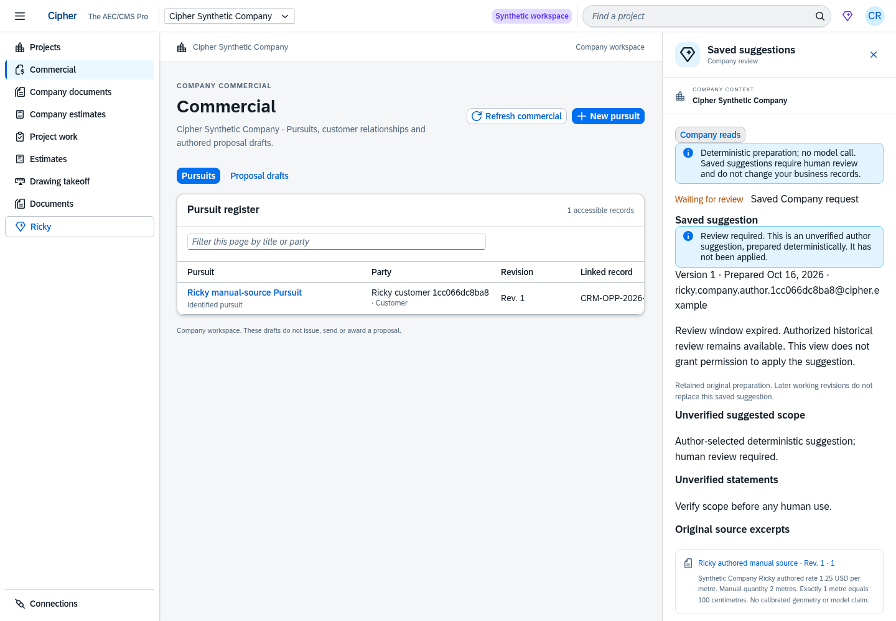
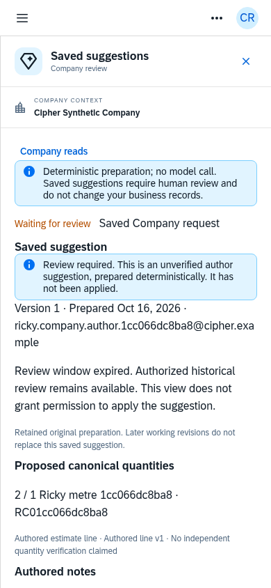

# Actual SAP UI5 saved-suggestion screens

These are original Chromium screenshots of the production build connected to the real isolated ERPNext backend, using synthetic business records. No images or API responses were generated or mocked. The capture reused the existing authenticated author session and issued 23 actual API GETs with no business commands, login or logout. Fifteen font responses succeeded; no browser/resource error occurred. [Capture verification](verification.json) and [source/build hashes](source-build-hashes.json) retain provenance.

| Flow | Desktop · 1440 px | Tablet · 900 px | Phone · 390 px |
| --- | --- | --- | --- |
| Select scope inputs | [Open](01-scope-selection-1440.png) | [Open](01-scope-selection-900.png) | [Open](01-scope-selection-390.png) |
| Review the saved scope | [Open](02-saved-scope-1440.png) | [Open](02-saved-scope-900.png) | [Open](02-saved-scope-390.png) |
| Review saved estimate quantities | [Open](03-saved-estimate-1440.png) | [Open](03-saved-estimate-900.png) | [Open](03-saved-estimate-390.png) |

The assistant uses a docked desktop panel and a full-width phone panel. Screens show the initial scroll position; further sources and metadata continue inside the scrollable panel. Original saved suggestions remain visible after working revisions advance. The elapsed review window is shown accurately. The capture does not perform a new Start or Stop; those commands have separate actual HTTP/RQ qualification.

The live model remains unconnected. These deterministic suggestions have not been applied to a business record. The [earlier connected gallery](../../company-ricky-native-r10/ui/README.md) also shows Pursuits, estimates, documents and Company reads.
