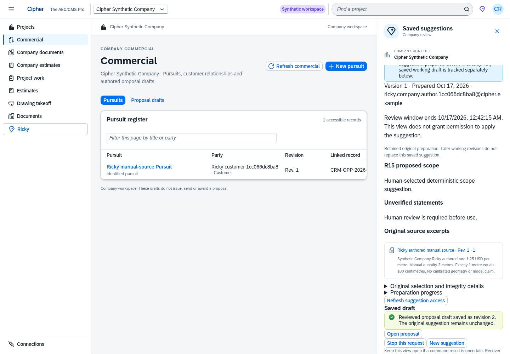
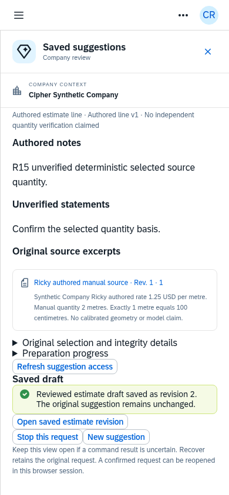

# Actual running R15 SAP UI5 screens

These are screenshots of the production Cipher SAP UI5 build connected to the isolated ERPNext/Frappe runtime. The business records are labeled synthetic fixtures. The browser used the original authenticated author session and actual API responses; no API response was mocked and no image was generated.

The three capture batches passed with thirteen screenshots, 48 API GETs, no business commands, login, model call, blocked request or browser/resource error. The initial batch opens the original saved suggestion, requests its real draft-save subject and displays the retained application and revision. The saves themselves were performed and independently verified through real author HTTP/RQ qualification immediately before capture. Later batches show a reviewed eligible draft, then that same unsaved suggestion after its original deadline passed naturally; only the UI acknowledgment checkbox was selected, and Save was never clicked.

| Actual screen | Desktop 1440 | Tablet 900 | Phone 390 |
| --- | --- | --- | --- |
| Working-record selection | [Open](01-working-record-selection-1440.png) | [Open](01-working-record-selection-900.png) | [Open](01-working-record-selection-390.png) |
| Saved scope draft | [Open](02-saved-scope-draft-1440.png) | [Open](02-saved-scope-draft-900.png) | [Open](02-saved-scope-draft-390.png) |
| Saved estimate draft | [Open](03-saved-estimate-draft-1440.png) | [Open](03-saved-estimate-draft-900.png) | [Open](03-saved-estimate-draft-390.png) |
| Reviewed draft ready to save | [Open](04-reviewed-draft-ready-1440.png) | Not captured | [Open](04-reviewed-draft-ready-390.png) |
| Same unsaved draft after natural expiry | [Open](05-expired-unsaved-draft-1440.png) | Not captured | [Open](05-expired-unsaved-draft-390.png) |

[Initial verification](verification.json), [eligible-state verification](eligible-verification.json), [expired-state verification](expired-verification.json) and [production build provenance](served-build-provenance.json) retain screenshot hashes. The 905-file build catalogue was captured after the first nine screenshots; sixteen subsequently fetched HTML/static resources matched their build bytes exactly, and the same complete build catalogue remained unchanged through the four additional captures. No before-capture byte catalogue is claimed for the initial batch. Mocked Playwright browser qualification is recorded separately.
